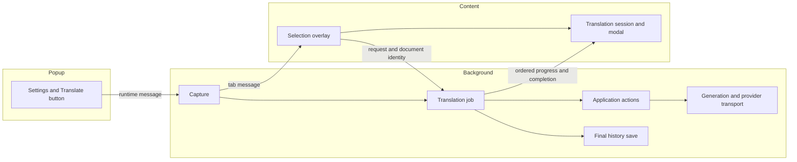

# Contributing to and maintaining Rosseta

Rosseta is a Chrome and Firefox extension built with Manifest V3, TypeScript, Bun, Svelte 5 and Tailwind CSS. It uses ports and adapters: core code defines what the app needs, and adapters connect it to browsers, storage and AI providers. This guide explains setup, where code belongs, how to make common changes and how to check them. [FLOW.md](FLOW.md) walks through translation and testing with excerpts from the source code.

- [Setup](#setup)
- [Architecture](#architecture)
- [Injected UI reading order](#injected-ui)
- [Where to change the code](#find-the-owner)
- [Follow a translation from start to finish](#read-a-normal-translation)
- [Key terms and where data is kept](#terms-and-state)
- [Coding rules](#coding-conventions)
- [Tests and checks](#tests-and-verification)
- [Adding a provider](#adding-a-provider)
- [Common changes](#common-changes)
- [Rules to keep when making changes](#contracts-to-preserve)
- [Pull requests and releases](#pull-requests-and-releases)
- [Updating the guides](#documentation-responsibilities)

## Setup

Use Bun 1.4.2, or the version set in CI. Releases use Node 22.

```bash
bun install
bun run dev:chrome
# Or:
bun run dev:firefox
```

Load `dist/chrome` as an unpacked extension in Chrome. In Firefox, load `dist/firefox/manifest.json` through `about:debugging`. The popup updates through hot module replacement (HMR); background and content scripts rebuild separately. Keep the popup HTML's script URL starting from the extension root.

| Command                                          | Purpose                                                   |
| ------------------------------------------------ | --------------------------------------------------------- |
| `bun run dev:chrome` / `dev:firefox`             | Development server for the selected browser               |
| `bun run build:dev:chrome` / `build:dev:firefox` | Watch development builds                                  |
| `bun run build:prod`                             | Production Chrome and Firefox builds                      |
| `bun run format`                                 | Format maintained source, configuration and documentation |
| `bun run format:check`                           | Check formatting without changing files                   |
| `bun run lint`                                   | Oxlint with warnings treated as failures                  |
| `bun run check`                                  | Svelte and TypeScript checks                              |
| `bun run test`                                   | Run logic, Svelte UI and tests using the installed SDK    |

## Architecture

Adapters depend on core, rather than the other way around. Core contains the app's rules, actions and interfaces, plus shared types and errors. It does not depend on a UI framework. Keep browser APIs and provider SDK code in adapters. Composition creates the implementations and passes each feature a small object containing the dependencies it needs.

Group related features within the existing layers. A new folder does not need its own domain object, interface or service. Each application action should complete one user task. Parsing, retrying and rendering are steps that support those tasks; they do not each need a use case. Keep the ports and adapters structure without adding containers for entire layers or a general retry framework.

```text
src/core/
  domain/                Immutable values, entities and pure selection rules
  application/
    translation/         Resolve configuration; validate and translate input
    history/             Save, query and delete final results
    providers/           Custom configuration and model catalog actions
    credentials/         API keys and key selection
    preferences/ settings/ shortcuts/
  ports/                 Inbound actions; outbound persistence/services
src/adapters/primary/
  background/            Browser jobs, capture, handlers and messaging
  content/               Content sessions, capture, Shadow DOM and messaging
  ui/                    Svelte components, controllers, contexts and popup lifetime
src/adapters/secondary/
  translation/           Shared generation engine, output, previews, compatibility
    execution/           Explicit generation/repair, route selection and budget
    errors/              Provider failure interpretation and trusted details
    transports/ai-sdk/   Installed AI SDK integration and its option types
  providers/             Explicit factories, native controls, requests, catalogs, Puter
  storage/               Browser storage grouped by capability
src/composition/         Background/popup roots and storage constructors
src/shared/              Result, errors, wire contracts and pure serialization
```

- **Composition:** [background.ts](src/composition/background.ts) and [popup.ts](src/composition/popup.ts) are the places where dependencies are put together. [storage.ts](src/composition/storage.ts) creates storage implementations. The popup does not create provider or network clients. Feature code must not import these composition entry points.
- **Translation:** core validates input and calls `ITranslationService` once. Primary adapters manage translation jobs in the browser; saving history is a separate action. All providers use one generation engine. Provider factories supply the transport and compatibility context, so the engine does not need to discover providers itself.
- **Generation:** the [module guide](src/adapters/secondary/translation/README.md) explains the steps: generate a response, inspect it, run one repair stage if needed, then accept the final result. Initial generation and repair share the fallback runner, request selection, attempt limits and deadline. Repair is an internal step, not a public action or provider interface.
- **Errors:** the [provider failure classifier](src/adapters/secondary/translation/errors/classify-generation-failure.ts) is the only place that decides what a provider failure means. The runner acts on that decision, and compatibility code records what the failure proves about feature support. Errors from building requests, delivering progress locally, storage, checking final output or converting it to a domain result do not go through this classifier. If the operation was stopped, the outer error handler keeps its original error. It also keeps existing `AppError` instances and uses `AppError.fromUnknown` for other unexpected local exceptions. Local failures never change recorded provider support.
- **Models:** keep fixed [provider definitions](src/core/domain/provider/provider-definitions.ts), saved model lists and the popup's reactive copies separate. [model-selection.ts](src/core/domain/preferences/model-selection.ts) chooses the model without reading or writing storage. There is no shared, changeable global model list.

Create provider SDK clients in the background. Popup and content code must not import that construction code, and background code must not import UI components or styles. When changing imports or how dependencies are created, check the affected entry points.

<a id="injected-ui"></a>

## Injected UI

The page UI lives in [ui/injected](src/adapters/primary/ui/injected). Read each component alongside its controller and the controller's adjacent test. Components declare markup, bindings and lifecycle hooks; controllers own state, event decisions, asynchronous work and cleanup. Pure transformations stay functions. Do not introduce a controller just to forward a DOM call, or split a small view into one-use wrappers.

Start with the three visible features:

| Feature            | Read in this order                                                                                                                                                                                                                                                                                                                                                                                                         | Responsibility                                                                                                                                                                                                                          |
| ------------------ | -------------------------------------------------------------------------------------------------------------------------------------------------------------------------------------------------------------------------------------------------------------------------------------------------------------------------------------------------------------------------------------------------------------------------- | --------------------------------------------------------------------------------------------------------------------------------------------------------------------------------------------------------------------------------------- |
| Area selection     | [ScreenSelectionOverlay](src/adapters/primary/ui/injected/screen-overlay/ScreenSelectionOverlay.svelte), [OverlayController](src/adapters/primary/ui/injected/screen-overlay/OverlayController.svelte.ts), [ScreenSelectionController](src/adapters/primary/ui/injected/screen-overlay/ScreenSelectionController.svelte.ts), [cropSelectionImage](src/adapters/primary/ui/injected/screen-overlay/crop-selection-image.ts) | Render the captured screenshot, wait for readiness, select a rectangle and submit its native-resolution PNG crop.                                                                                                                       |
| Translation result | [TranslationModal](src/adapters/primary/ui/injected/translation-result-modal/TranslationModal.svelte), [TranslationModalController](src/adapters/primary/ui/injected/translation-result-modal/TranslationModalController.svelte.ts), [TranslationResult](src/adapters/primary/ui/injected/translation-result-modal/TranslationResult.svelte)                                                                               | Render the dialog frame and the current progress, accepted result or failure. The controller implements the content session's [TranslationView](src/adapters/primary/ui/injected/translation-result-modal/TranslationView.ts) contract. |
| Notifications      | [ToastContainer](src/adapters/primary/ui/injected/toast/ToastContainer.svelte), [ToastController](src/adapters/primary/ui/injected/toast/ToastController.svelte.ts), [ToastNotification](src/adapters/primary/ui/injected/toast/ToastNotification.svelte)                                                                                                                                                                  | Render queued notifications; manage retry actions, replacement, expiry and dismissal.                                                                                                                                                   |

For modal details, follow the responsible controller:

- [TranslationSegmentsController](src/adapters/primary/ui/injected/translation-result-modal/TranslationSegmentsController.svelte.ts) groups rows, joins copy text, computes language labels/colors and pairs hover by source index. Preview row keys include the attempt revision; final rows use validated block grouping.
- [ModalViewportController](src/adapters/primary/ui/injected/translation-result-modal/ModalViewportController.svelte.ts) connects DOM measurements, focus and Escape to the modal. [ModalLayoutController](src/adapters/primary/ui/injected/translation-result-modal/ModalLayoutController.svelte.ts) chooses stacked or column layouts, following the user’s resized modal width without locking the dialog to a column minimum. Stacked dialogs use a 480px minimum (capped at 90vw); resizing an internal text/description box preserves that arrangement until the outer dialog is resized or a new attempt starts. [Measurement functions](src/adapters/primary/ui/injected/translation-result-modal/modal-layout-measurement.ts) use temporary hidden copies and always remove them.
- [ModalDragController](src/adapters/primary/ui/injected/translation-result-modal/ModalDragController.svelte.ts) manages position and drag listeners. [TranslationCopyController](src/adapters/primary/ui/injected/translation-result-modal/TranslationCopyController.svelte.ts) manages clipboard feedback and ignores results from old attempts.
- [TextSectionController](src/adapters/primary/ui/injected/translation-result-modal/components/TextSectionController.ts) handles segment hover and suppresses it during resizing. [SectionResizeController](src/adapters/primary/ui/injected/translation-result-modal/components/SectionResizeController.ts) owns the active resize; [section-resize](src/adapters/primary/ui/injected/translation-result-modal/components/section-resize.ts) applies dimensions and restores neighbouring sections.

[TranslationTextPanel](src/adapters/primary/ui/injected/translation-result-modal/TranslationTextPanel.svelte) composes a labeled copy control and [TextSection](src/adapters/primary/ui/injected/translation-result-modal/components/TextSection.svelte). Text and romanization have separate renderers. [DescriptionSection](src/adapters/primary/ui/injected/translation-result-modal/components/DescriptionSection.svelte) preserves the resizable description box while [DescriptionMarkdown](src/adapters/primary/ui/injected/translation-result-modal/components/DescriptionMarkdown.svelte) renders safe Markdown. Raw HTML stays inactive, images become alternative text, and only absolute HTTP(S) links are active.

Browser messaging, request ordering and cancellation belong to [content/translation](src/adapters/primary/content/translation). [mountTranslationModal](src/adapters/primary/ui/injected/translation-result-modal/mountTranslationModal.svelte.ts) creates the Shadow DOM host, registers theme updates, and disposes the view on detach. UI code receives display data and callbacks. Only completed, validated translations can be copied. Keep existing CSS classes and theme tokens in the extension stylesheet, [translation-modal.css](src/adapters/primary/ui/injected/translation-result-modal/translation-modal.css) and [toast.css](src/adapters/primary/ui/injected/toast/toast.css).

Every controller has an adjacent Vitest suite. Rendered modal, Markdown and toast tests cover component wiring; controller tests cover decisions and resource lifetimes. Section 22 of [FLOW.md](FLOW.md#section-22) explains phases, layouts, copying, resizing and notifications. Add comments only when a non-obvious constraint cannot be expressed clearly through names and code.

<a id="find-the-owner"></a>

### Where to change the code

| Change                                       | Start with                                                                                                                                                                                                                                                                                                          |
| -------------------------------------------- | ------------------------------------------------------------------------------------------------------------------------------------------------------------------------------------------------------------------------------------------------------------------------------------------------------------------- |
| Background construction and startup          | [background composition](src/composition/background.ts) and [service worker](src/adapters/primary/background/service-worker.ts)                                                                                                                                                                                     |
| Popup construction                           | [popup composition](src/composition/popup.ts) and [popup entry](src/adapters/primary/ui/extension/main.ts)                                                                                                                                                                                                          |
| Start, progress and end of a translation     | [TranslationJobCoordinator](src/adapters/primary/background/translation/TranslationJobCoordinator.ts)                                                                                                                                                                                                               |
| Choosing the key, model and preferences      | [ResolveTranslationConfigurationUseCase](src/core/application/translation/ResolveTranslationConfigurationUseCase.ts)                                                                                                                                                                                                |
| Steps in translation                         | [execute-translation](src/adapters/secondary/translation/execute-translation.ts), [repair operation](src/adapters/secondary/translation/execution/repair-translation-response.ts) and [module guide](src/adapters/secondary/translation/README.md)                                                                  |
| Fallback choices and attempt limits          | [shared runner](src/adapters/secondary/translation/execution/generate-with-fallback.ts), [selection](src/adapters/secondary/translation/execution/generation-selection.ts) and [budget](src/adapters/secondary/translation/execution/generation-budget.ts)                                                          |
| Deciding what a provider error means         | [single classifier](src/adapters/secondary/translation/errors/classify-generation-failure.ts), the helper that reads trusted error details, and the helper that matches rejected settings                                                                                                                           |
| Creating provider clients                    | [create-provider-runtime](src/adapters/secondary/providers/create-provider-runtime.ts)                                                                                                                                                                                                                              |
| Partial output                               | [TranslationAttemptPreview](src/adapters/secondary/translation/preview/TranslationAttemptPreview.ts)                                                                                                                                                                                                                |
| Checking and saving provider feature support | [TranslationCapabilityState](src/adapters/secondary/translation/compatibility/TranslationCapabilityState.ts), [Journal](src/adapters/secondary/translation/compatibility/TranslationCapabilityJournal.ts), and [browser store](src/adapters/secondary/storage/compatibility/BrowserTranslationCapabilityStorage.ts) |
| Completed results                            | [history actions](src/core/application/history) and [history storage](src/adapters/secondary/storage/history)                                                                                                                                                                                                       |
| Showing and closing the page's result modal  | [content translation module](src/adapters/primary/content/translation) and [modal controller](src/adapters/primary/ui/injected/translation-result-modal/TranslationModalController.svelte.ts)                                                                                                                       |

<a id="read-a-normal-translation"></a>

### Follow a translation from start to finish

1. The background message handler passes the request and the verified sender's details to `TranslationJobCoordinator`.
2. Configuration resolution chooses the credential, such as an API key, once and returns a snapshot: a copy of the settings for this translation. Composition creates the provider runtime and a translation use case that works with any provider.
3. `TranslateImageUseCase` validates the input. `TranslationServiceAdapter` then calls the shared generation engine.
4. The engine sets up cancellation and the deadline, shared attempt limits, and the model's recorded feature support. It generates a response, checks it, and may run one repair stage. Initial generation and repair use the same fallback runner. When the result passes all checks, the engine records which settings actually succeeded and converts the final data to the app's translation type.
5. The coordinator makes the final decision to save the result, writes history, and sends completion. The content session accepts progress messages in order for the document that started the request. Its modal controller updates the display.

For fallback and repair, start with the [translation module guide](src/adapters/secondary/translation/README.md). The runner calls the provider; selection chooses request settings; the budget tracks the remaining attempts; output code decides whether a result can be accepted; repair manages the one repair step. The classifier decides what provider failures mean. Local failures in progress delivery, storage or result conversion bypass it. Background and content translation modules handle browser messages, recovery after interrupted delivery, and when jobs start and end.



The popup, background worker and content script each have their own memory and can start or stop independently. They communicate through messages. Importing the same source file does not make them share an object at runtime.

<a id="terms-and-state"></a>

### Key terms and where data is kept

- A **translation** is the final result the app has accepted. A **draft** is preview data converted to a common shape; it can still change or fail validation.
- A **schema** describes the expected JSON shape. A **mode** combines whether a request uses structured output or plain JSON and whether the response is streamed or buffered until complete.
- A **provider factory** is a function that sets up a provider client. It supplies a **transport**, which sends a request and reads the response, and a **context**, which holds information about the provider and model.
- A **configuration** is one declared set of provider request controls. Its ID identifies that set; callers do not need to interpret the ID.
- **Compatibility** means the feature support recorded for a provider and model. A **compatibility fact** says that support is unknown, supported or unsupported for a particular model, schema or settings combination.
- A **namespace** groups a provider's compatibility records so they can be reset together. A compatibility **generation** is a reset version that prevents observations made before a reset from being saved afterward.
- A **job** is the work started by a verified document. An **attempt** is one call to generate a response within that job. An **attempt receipt** records the response and the request settings actually used.
- A **retry** makes another call after a temporary failure. A **fallback** changes settings after the provider rejects a feature or a combination of settings. A **repair** asks for corrected output after a completed response fails the final checks. There is only one repair stage, but it can use fallback or the remaining retry; it does not get new attempts or extra time.

| State                                | Where it lives and when it is kept or cleared                                                                                                                                                                                       |
| ------------------------------------ | ----------------------------------------------------------------------------------------------------------------------------------------------------------------------------------------------------------------------------------- |
| Credentials, active key and rotation | Credential and key-selection stores choose one credential for each translation.                                                                                                                                                     |
| Provider details and model lists     | Built-in definitions stay fixed; `IModelStorage` saves fetched model lists. Popup hooks keep their own copies.                                                                                                                      |
| Model refresh and provider removal   | The [provider mutation lock](src/adapters/secondary/storage/providers/BrowserProviderMutationLock.ts) prevents refresh writes and staged removal from changing the same provider at once. Network requests happen outside the lock. |
| Saved model and language choices     | The preferences store saves them. Application actions use the shared selection rule to choose valid settings.                                                                                                                       |
| Recorded feature support             | State interprets observations, Journal combines them and retries failed writes, and browser storage saves them. A reset version rejects writes from before the reset.                                                               |
| Remaining generation attempts        | One `GenerationBudget` covers initial generation and repair. Changing the phase or configuration does not reset it.                                                                                                                 |
| Request settings already tried       | One `GenerationSelection` tracks configurations across phases. It starts fresh mode history for each new phase or configuration.                                                                                                    |
| Running and finished jobs            | The background request registry keeps jobs in memory and keeps a limited number of finished-job summaries. Jobs are not saved across worker restarts.                                                                               |
| Preview text and timers              | One `TranslationAttemptPreview` manages them and cleans them up before the next attempt.                                                                                                                                            |
| Progress delivery and ordering       | The background progress publisher and content session each handle their side of message delivery, revisions and sequence numbers.                                                                                                   |
| What the modal displays              | The modal controller updates the view, allows copying only final results, and controls how long copy feedback appears.                                                                                                              |
| Popup reads and listeners            | Popup startup loads settings and registers listeners. Cleanup removes them when the popup unmounts; guards prevent unfinished reads from publishing results afterward.                                                              |
| Pending key deletions                | The Manage Keys controller manages the Undo timer and saves deletions one at a time. Final cleanup continues when the page closes.                                                                                                  |
| Saved history                        | The history store saves only validated final results. It uses a Web Lock across browser contexts when available, or a queue within each JavaScript environment otherwise.                                                           |

<a id="coding-conventions"></a>

## Coding rules

Run `bun run format` before submitting. Prettier formats source files, Svelte scripts, templates, styles and documentation with single quotes and LF line endings. `.prettierignore` skips generated output and local files. Code examples in Markdown keep their formatting.

- **Types and errors:** use strict TypeScript, `unknown` instead of `any`, and `import type`. Return `Result<T, AppError>` for expected application and storage failures. At adapter boundaries, convert unknown exceptions using the existing error subclasses.
- **Scope:** give each class one purpose. Extract a helper when it has a clear rule, transformation or resource to manage. Share repeated code, but avoid frameworks for hypothetical needs and classes that only forward calls. One use-case file handles one public action. Internal retry, parsing, transport and rendering steps are not separate actions.
- **Interfaces and tests:** prefix port interfaces with `I`. Prefer tests that check the interface's promised behavior using in-memory implementations from `tests/fakes`.
- **UI:** use Svelte 5 runes, a `Props` interface and tested controllers for behavior. Smart pages connect typed context and browser dependencies. Display components receive props and callbacks. Components wire DOM events and lifecycle hooks; controllers own behavior. Keep each component focused and every controller beside its tests. Store the popup's copies of state in `ui/extension/state` and reusable controls in `ui/shared/components`. See [UI owners](src/adapters/primary/ui/).
- **Styling:** use Tailwind's named theme tokens (`bg-background`, `text-foreground`, `border-border`), check both themes, and add UI to web pages through the Shadow DOM host.
- **Resources:** keep one implementation responsible for each queue, journal, lease or other managed resource. A lease gives temporary access to a shared resource. Remove temporary compatibility wrappers once all callers use the new code.

<a id="tests-and-verification"></a>

## Tests and checks

Keep tests beside the code they test, except for tests using the installed SDK. Test runners find files by path, so moving a test to the wrong folder can stop it from running.

| Runner                       | Files it tests                                                                         | Test import |
| ---------------------------- | -------------------------------------------------------------------------------------- | ----------- |
| `bun run test:logic`         | `src/core`, `src/shared`, `src/composition`, background/content and secondary adapters | `bun:test`  |
| `bun run test:ui`            | `src/adapters/primary/ui`, including `.svelte.ts` controllers                          | `vitest`    |
| `bun run test:streaming-sdk` | `tests/*-sdk-integration.test.ts`                                                      | `vitest`    |

Bun's preload replaces browser APIs, Svelte and SDK calls with test versions. UI Vitest compiles components and `.svelte.ts` controllers; run tests that use Svelte runes there, rather than in Bun. Installed-SDK tests use the actual SDK with a separate Node configuration and no Bun preload. Tests with a mocked SDK do not prove how the real SDK behaves.

Bun logic tests use explicit paths starting with `./`, and UI Vitest has an explicit list of source paths to include. Keep these restrictions: substring filters can also match archived source folders. After moving tests, check the file names in the runner's output, not just the number of passing cases.

Installed-SDK tests also check rejected promises under browser-like conditions. The SDK handles telemetry differently in Node, which can hide failures caused by how long promises remain pending in an extension. The transport explicitly disables telemetry because the app does not use it.

```bash
bun test src/core/application/history/ClearAllTranslationsUseCase.test.ts
bunx vitest run src/adapters/primary/ui/extension/pages/manage-keys/ManageKeysController.test.ts
bun run test:streaming-sdk
```

Test behavior that callers can observe, including errors, cancellation and work that finishes after it is no longer needed. Use fixed provider request, stream and error examples so tests are repeatable; do not call paid or live APIs. When moving files, update runner paths, mock paths, imports and configurations together. Then check the runner's output to confirm that it found the tests.

Before accepting a change that combines work across modules, run:

```bash
bun run format:check
bun run lint
bun run check
bun run test
bun run build:prod
git diff --check
```

Pull request checks run `lint`, `test`, `typecheck` and `build`. The required **Verify & Test** check combines their results and fails if any required check fails or is skipped. Contributors outside the project may still need workflow approval, and CODEOWNERS review requirements still apply.

## Adding a provider

Providers must accept images. Structured output and streaming are optional: the shared engine records whether the model supports them and uses a fallback when needed. Keep provider-specific fields out of core translation types, UI interfaces and browser message formats.

1. **Provider identity:** update [Provider.ts](src/core/domain/credential/Provider.ts) and the fixed [provider-definitions.ts](src/core/domain/provider/provider-definitions.ts). Default model IDs are suggestions, not a current list of available models. Assign API keys to providers explicitly; never guess the provider from a key's prefix.
2. **Provider runtime:** add a [builtin factory](src/adapters/secondary/providers/builtin) with one clear purpose, following [groq-runtime.ts](src/adapters/secondary/providers/builtin/groq-runtime.ts). Take the key and model as explicit inputs and return `{ transport, context }`. Use `createProviderContext` so provider identity is built consistently. See [custom factories](src/adapters/secondary/providers/custom) for other API formats.
3. **Construction:** add a case to [create-provider-runtime.ts](src/adapters/secondary/providers/create-provider-runtime.ts), keeping every provider covered. Reuse `TranslationServiceAdapter`. Do not add a provider-specific `ITranslationService` wrapper or copy the generation logic.
4. **Connection and model list:** set the default endpoint and API format in [provider-connection.ts](src/adapters/secondary/providers/provider-connection.ts). Keep the existing hashing rules and identities in [translation-capability-key.ts](src/adapters/secondary/translation/compatibility/translation-capability-key.ts). Add model fetching in [ModelFetchService.ts](src/adapters/secondary/providers/catalogs/ModelFetchService.ts), reusing helpers for the same API format where useful. Preserve headers, query parameters and error conversion. Let users enter model IDs manually when the provider has no model-list API.
5. **Thinking controls:** declare the provider's documented settings for disabling or minimizing thinking in [providers/thinking](src/adapters/secondary/providers/thinking). Pass them through the factory's `createProviderSdkTransport`. Keep the provider's defaults for unknown models or endpoints. If the installed SDK leaves out a verified field, use a model factory tied to that configuration and [configured-generation-fetch.ts](src/adapters/secondary/providers/requests/configured-generation-fetch.ts). Preserve cancellation, images, custom headers and query parameters. Link official sources beside the declarations and request examples. Use [installed-SDK fixtures](tests/thinking-sdk-integration.test.ts) to check the actual request fields.
6. **Display:** update badge colors and setup URLs in [providers.ts](src/adapters/primary/ui/shared/constants/providers.ts). Add provider-specific instructions only when its setup differs.
7. **Checks:** extend [runtime tests](src/adapters/secondary/providers/create-provider-runtime.test.ts), model-list tests and request and control examples. Use the installed SDK to check request formatting and streaming. Run lint, type checks, tests and both browser builds. Keep shared fallback behavior and the existing core and UI interfaces.

A client that does not use AI SDK implements [ITranslationGenerationTransport](src/adapters/secondary/translation/transports/GenerationTransport.ts). That adapter converts its SDK's events, errors and completed responses into the shared format. [PuterGenerationTransport.ts](src/adapters/secondary/providers/puter/PuterGenerationTransport.ts) gives translation and model-list calls temporary, exclusive access to one shared authentication client. Calls run one at a time. Cancelling a translation cannot stop a request already submitted to Puter, and the SDK may make its own HTTP retries.

DeepSeek uses its own SDK and declares which plain-JSON modes its installed transport allows. NVIDIA uses an OpenAI-compatible client. These transport declarations describe SDK limits for the current request; they do not mean a model permanently lacks a feature.

## Common changes

- **Add a provider:** Follow [the provider checklist](#adding-a-provider): identity, fixed provider details, runtime factory, API format, endpoint, model list, thinking controls and display details. Extend the construction, request and model-list tests. Keep the existing core interfaces and browser message formats.
- **Change the prompt or response schema:** Start in [output](src/adapters/secondary/translation/output). Update the prompt, schema and final validation together. Check required keys when descriptions are off, and how output becomes preview data. Run parser, normalizer, schema and installed-SDK tests. Changes to output meaning or prompt and schema hashes are behavior changes; make them deliberately.
- **Debug a provider HTTP 400:** Save the response with secrets removed, the mode and configuration actually used, and the declared control. Start with [classify-generation-failure](src/adapters/secondary/translation/errors/classify-generation-failure.ts). Its [detail reader](src/adapters/secondary/translation/errors/provider-error-details.ts) reads trusted error fields, and its [configuration matcher](src/adapters/secondary/translation/errors/configuration-rejection.ts) identifies rejected settings. Add the exact response as a test example. Check that fallback happens and that later requests skip the rejected option using saved compatibility. HTTP 400 alone does not prove a feature is unsupported.
- **Change model selection:** Start with [the selection rule](src/core/domain/preferences/model-selection.ts), then configuration resolution, [catalog refresh](src/core/application/providers/RefreshProviderModelsUseCase.ts) and the popup display. Test saved and default choices, removed models and empty lists. Keep storage and error handling in the actions responsible for them.
- **Change injected UI:** Follow the [reading order](#injected-ui), edit the component or controller responsible, and run its adjacent Vitest tests plus rendered integration tests. Use existing styles and theme tokens. Preserve native-resolution cropping, stable resized boxes across snapshots, compact failure bodies, session registration and final-only copying.
- **Change history or retention:** Start with [retention](src/core/domain/translation/translation-history-retention.ts), [history actions](src/core/application/history) and the [browser history store](src/adapters/secondary/storage/history). Test dates at the expiry boundary, removal of old entries, backup replacement and simultaneous writes. Keep the shared lock and queue.
- **Change export/import:** Start with [SettingsBackup](src/core/domain/settings/SettingsBackup.ts), the [settings actions](src/core/application/settings), [snapshot storage port](src/core/ports/outbound/ISettingsBackupStorage.ts) and [browser snapshot adapter](src/adapters/secondary/storage/settings/BrowserSettingsBackupStorage.ts). Export reads one persisted snapshot without repairing storage. Import validates everything before one scoped write, preserving history when older backups omit it. Keep provider/history locking, the 90-day boundary, unknown-provider rejection and compatibility exclusion. The [Settings controller](src/adapters/primary/ui/extension/pages/settings/SettingsController.svelte.ts) owns file/download lifetimes and refresh feedback.
- **Change saved storage:** Start with the relevant outbound port, which defines the storage interface, and the [storage module](src/adapters/secondary/storage) for that feature. Then check encoding, decoding, validation of stored values, and settings backup tests. Preserve existing keys and formats or write an explicit migration. Run the focused tests for compatibility identities, reset markers and history locking.
- **Change API key deletion:** Start with [ManageKeysController](src/adapters/primary/ui/extension/pages/manage-keys/ManageKeysController.svelte.ts). Test consecutive deletions, Undo for only the latest deletion, delayed saves, failures, duplicate events and page cleanup. Keep saves ordered, and keep model cleanup when the last key is removed.

<a id="contracts-to-preserve"></a>

## Rules to keep when making changes

- **Service:** `ITranslationService` returns `Promise<Result<Translation, AppError>>`. Optional execution settings carry cancellation, a fixed end time and a progress callback that works with any provider. Providers that return a complete response at once may send no previews.
- **Attempt limits and repair:** allow at most **six** generation calls within one **60-second** generation deadline. Initial generation, fallback after rejected controls or modes, restart and repair all share those limits and the same runner. Preparation and saving the result have separate coordinator time limits. Stop when a valid result is accepted. Allow one restart with a buffered response, including during repair. Never repair a repair response again. Prefer a buffered repair mode known to work. If attempts run out, keep the actual error. Record final compatibility using the successful attempt receipt, which identifies the settings actually used. Six calls do not probe every possible combination and do not limit the SDK's own HTTP retries.
- **When compatibility expires:** save both supported and unsupported results for a fixed **7-day** period. Check expiry when a translation needs the records, and start a fresh period if they have expired. Normal success does not extend the period. Model-list refresh resets the provider's compatibility records after saving the list. A failure before that save leaves compatibility unchanged. If the list is saved but the reset fails, report a partial failure.
- **What proves incompatibility:** mark a control or feature unsupported only when the provider explicitly rejects it. Authentication, quota, invalid input, network errors, temporary failures and malformed JSON do not prove lack of support. If a thinking control conflicts with a generation mode, record only that combination as unsupported; do not disable either feature everywhere. Skip configurations with no eligible modes without marking their controls unsupported. Keep general model support separate from support for a particular schema or configuration. Preserve reset versions that reject old observations, and preserve recovery after failed writes.
- **Output:** pair each source segment with its translation in order. When descriptions are disabled, remove them even if the provider sends one. Before asking for repair, try to recover a complete, valid response object from the generated text. Do not accept a nested success object when the containing response is conflicting or incomplete. A missing finish reason does not count as successful completion. Treat partial JSON as a preview and keep strict validation for the final result. Only accepted final results can be saved to history or copied.
- **Messages:** verify the sender and initiating document. Preserve request IDs, revisions, message sequence and acknowledgement order, cancellation, and recovery of completed or failed jobs. When adding an action, update the schema union, return map and receiving router together.
- **Stored changes:** remove history more than **90 days** after its creation on startup, access, changes and backup replacement. Use a Web Lock to order browser writes, with the queue as a fallback. Remove all data belonging to a custom provider before deleting its configuration. Manage Keys must save earlier deletions in order; Undo applies to the latest pending key only.
- **Stable formats:** a structural refactor must not silently change stored keys, encoding and decoding, compatibility identities, browser message data, prompt and schema behavior, or backup formats. Leave saved compatibility results out of backups; they are runtime support records, not user settings.

## Pull requests and releases

Use Conventional Commits, for example `fix(keys): serialize consecutive deletions` or `refactor(translation): group generation ownership`. Explain the problem, the behavior after the change, what changed and how you checked it. Include screenshots for UI changes.

Target `main`, address review comments and keep unrelated changes separate. Semantic release sets versions for `main` and `beta`, updates the manifest, and builds and packages both browsers. Do not edit package or manifest versions by hand.

<a id="documentation-responsibilities"></a>

## Updating the guides

Update this guide when code responsibilities, the suggested reading order, contributor commands or provider setup change. Update [FLOW.md](FLOW.md) for the detailed translation and testing walkthrough, and [CLAUDE.md](CLAUDE.md) for coding-agent instructions. Keep architecture decisions brief and link to the code responsible rather than copying its implementation. Refactor plans and check results describe past work; use the current guides and code to find responsibilities and commands.
